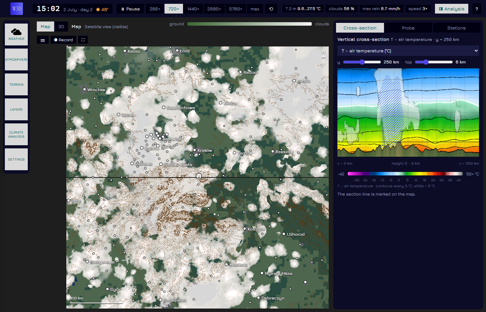

# Weather3D

A while ago, I was sitting with my friend, pondering if there was any possibility of creating something like Niels Daemen's "2D Weather Sandbox" but in 3D. It seemed to me that it was pretty much impossible, especially at the time we were talking. The biggest obstacle was, of course, the fact that I have close to no knowledge of professional programming. So while I have my own negative thoughts about AI usage in most cases, I felt that this was the right thing to use it on.

It goes without saying that this project is funded 100% out of my own pocket, and it is free to use or edit in any way, shape or form. I have always believed in open-source science, and anything made with AI in particular should not be monetized.

Now you can check out the simulation for yourself. It's still in its early form, so expect bugs (which I am happy to hear about).

**[▶ Open Weather3D](https://mesochaser2425.github.io/weather3d/)** – here you can open the simulation in your browser.

You need a current Chrome or Edge on a computer with a WebGPU graphics card; it will not work on phones. All the computing happens on your PC, so the simulation speed will depend on your card. On my RTX 5060 Ti, a simulated day on a 500 × 500 km map takes about 20 s at maximum speed. Starting takes a minute or so.



All of the weather is simulated by a separate synoptic model. It creates weather that fits the place and the season, and it does not use current observations.

## Features

- You can pick the starting area on a terrain map, change its size and pick the starting month.
- Switch between map layers like temperature, rain and snow, radar, satellite images, wind, CAPE, soil, snow cover and many more.
- Look at the clouds in a 3D view and fly through them. I must note that the cloud system is still a little bit janky.
- Dynamic soundings, hodographs and vertical cross-sections. Weather stations that record the data, with an easy-to-use CSV export system.
- You can compare months, seasons and years in the climate analysis tab.
- If you don't want real terrain, you can paint it, as well as water and surface types, while the simulation runs. You can also save the state to a file or a link.

## If you want to run it locally

Requires Node.js 20.19 or newer.

```
npm install
npm run dev
```

On Windows you can double-click `start.bat` instead. `npm run build` creates a static site in `dist/`. Any file hosting works, as there is no server-side code; this repository publishes it with GitHub Pages (`.github/workflows/pages.yml`).

Map data comes straight from the providers listed below, so terrain and land cover need an internet connection. The climate data is built in.

## How does it work?

The simulation runs in WebGPU compute shaders. Grid spacing ranges from 100 m to 25 km, with 50 vertical levels up to 20 km by default.

- **Dynamics:** anelastic equations on an Arakawa C grid, semi-Lagrangian advection, a pressure solver using FFT and conjugate gradients, terrain with shaved cells.
- **Turbulence:** 3D Smagorinsky, with a K-profile boundary layer on coarser grids.
- **Clouds and precipitation:** two-moment rain (after Morrison), cloud ice with crystal numbers, snow and graupel.
- **Convection:** a stochastic scheme (after Plant–Craig and Grandpeix–Lafore) with cold pools, which fades out as the grid starts to resolve storms; shallow and elevated convection.
- **Surface:** radiation with slopes and shadows, force-restore soil temperature, three soil water layers, snow, lakes and sea with ice, seasonal vegetation.
- **Large scale:** a primitive-equation model around the whole latitude circle (75 km grid, 12 levels) forms its own lows, highs and fronts and feeds the domain through its boundaries. Its zonal means and long waves are steered towards NCEP climatology.
- **Climate correction:** the model's own bias is measured on a separate copy of the large-scale model with its own weather and removed from the domain's target profiles (delta method), using the climate data of the chosen place.

Yearly runs over southern Poland were compared with station data. Yearly temperature and precipitation came out close to the norm, but cloud cover was too low and sunshine too high. Other regions have not been checked.

### Where things are

| Path | Contents |
|---|---|
| `src/main.js` | GPU buffers and pipelines, the order of a time step, coupling with the large-scale model, user interface |
| `src/shaders/sim.wgsl` | The domain model: surface, advection, turbulence, microphysics, convection, boundaries, pressure solver |
| `src/shaders/pe.wgsl`, `src/pe.js` | The large-scale model |
| `src/shaders/render.wgsl`, `view3d*.wgsl`, `vol.wgsl`, `atmo*.wgsl` | Maps, cross-sections and the 3D view |
| `src/geo.js` | Terrain, land cover and climate downloads |
| `src/climbase.js`, `zonclim.js`, `zonwave.js`, `soilclim.js` | Built-in climatologies, generated by scripts in `testy/` |
| `testy/` | Headless test scripts and data generators |

The user interface is in English; comments in the source code are in Polish.

## Data sources

| Source | Used for | Licence and credit |
|---|---|---|
| [ESA WorldCover 2021 v200](https://esa-worldcover.org), read from [Microsoft Planetary Computer](https://planetarycomputer.microsoft.com/dataset/esa-worldcover) | Land cover; telling land below sea level from the sea | CC BY 4.0. © ESA WorldCover project 2021 / Contains modified Copernicus Sentinel data (2021) processed by ESA WorldCover consortium. Zanaga et al. (2022), [doi:10.5281/zenodo.7254221](https://doi.org/10.5281/zenodo.7254221) |
| [Terrain Tiles on AWS](https://registry.opendata.aws/terrain-tiles/) | Terrain and the land–sea map | See the credits below |
| [GeoNames](https://www.geonames.org) | Place names in `public/cities`, selected and with Polish names | CC BY 4.0 |
| [Open-Meteo](https://open-meteo.com/) | ERA5 normals near the ground, downloaded in the background | CC BY 4.0, weather data by Open-Meteo.com. ERA5: Copernicus Climate Change Service |
| [NOAA PSL](https://psl.noaa.gov): NCEP/NCAR Reanalysis 1, GHCN_CAMS, GPCC, GPCP | Built-in climatologies | NCEP/NCAR Reanalysis, GHCN_CAMS, GPCC and GPCP data provided by the NOAA PSL, Boulder, Colorado, USA, from their website at https://psl.noaa.gov. Fan and van den Dool (2008), Schneider et al. (2011) |

<details>
<summary>Terrain Tiles credits</summary>

ArcticDEM terrain data DEM(s) were created from DigitalGlobe, Inc., imagery and funded under National Science Foundation awards 1043681, 1559691, and 1542736; Australia terrain data © Commonwealth of Australia (Geoscience Australia) 2017; Austria terrain data © offene Daten Österreichs – Digitales Geländemodell (DGM) Österreich; Canada terrain data contains information licensed under the Open Government Licence – Canada; Europe terrain data produced using Copernicus data and information funded by the European Union - EU-DEM layers; Global ETOPO1 terrain data U.S. National Oceanic and Atmospheric Administration; Mexico terrain data source: INEGI, Continental relief, 2016; New Zealand terrain data Copyright 2011 Crown copyright (c) Land Information New Zealand and the New Zealand Government (All rights reserved); Norway terrain data © Kartverket; United Kingdom terrain data © Environment Agency copyright and/or database right 2015. All rights reserved; United States 3DEP (formerly NED) and global GMTED2010 and SRTM terrain data courtesy of the U.S. Geological Survey. ([source](https://github.com/tilezen/joerd/blob/master/docs/attribution.md))

</details>

These are free services without any guarantee. If terrain does not load, the simulation starts on flat terrain. If land cover does not load, it uses a generated mosaic of fields and forests, and land below sea level is treated as sea.

The page has no account system and no tracking. It stores your settings in your browser, and your browser contacts the providers above directly, so they can see your IP address.

## Credits and licence

Weather3D is released under the [MIT licence](LICENSE). Data keeps the licences listed above. Software and fonts included in the page have their own licences: see [`public/THIRD-PARTY-LICENSES.txt`](public/THIRD-PARTY-LICENSES.txt) and [`public/fonts/OFL-Jura.txt`](public/fonts/OFL-Jura.txt).

The sounding chart layout follows the [thundeR](https://github.com/bczernecki/thundeR) soundings by Czernecki, Taszarek and Szuster, with its own code. The idea grew out of [2D Weather Sandbox](https://github.com/niels747/2D-Weather-Sandbox) by niels747.
